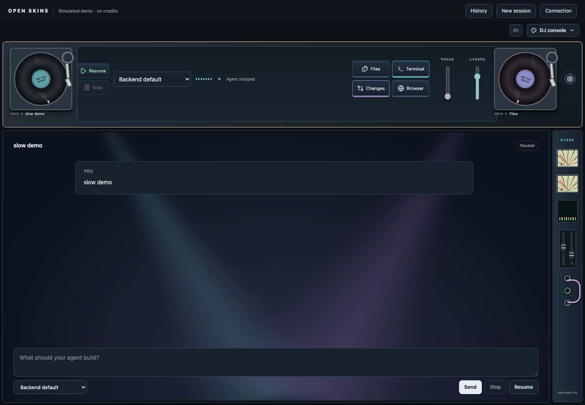
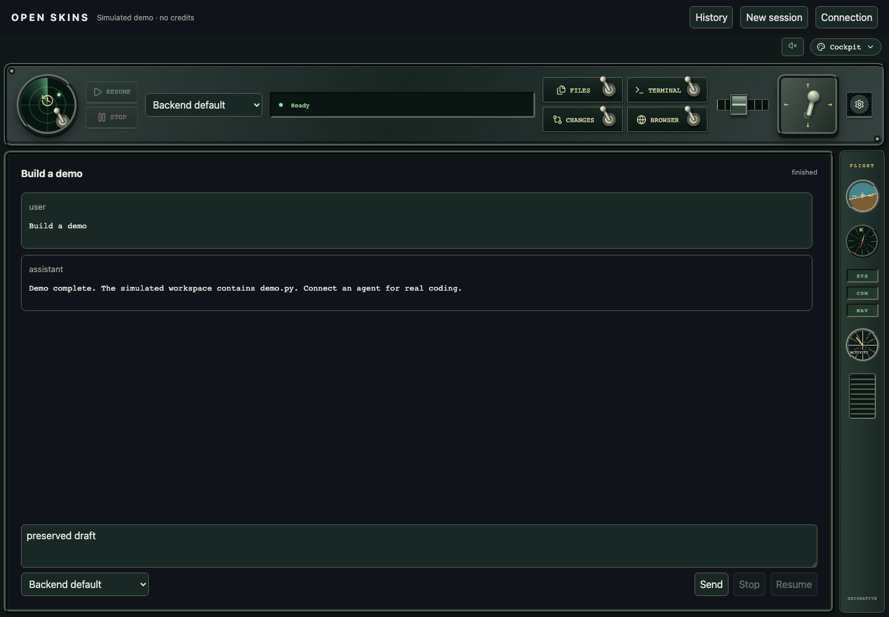
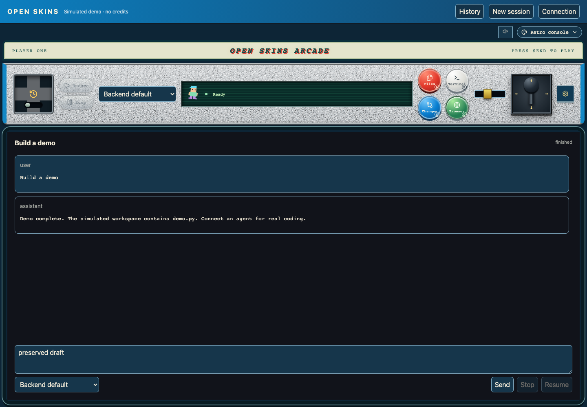
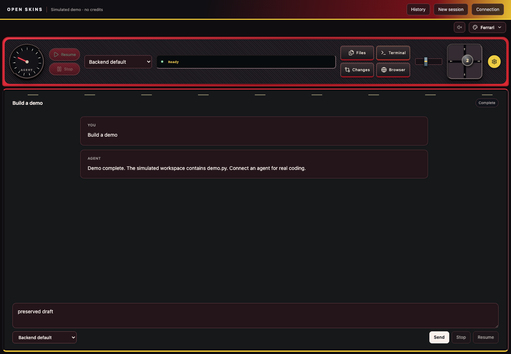
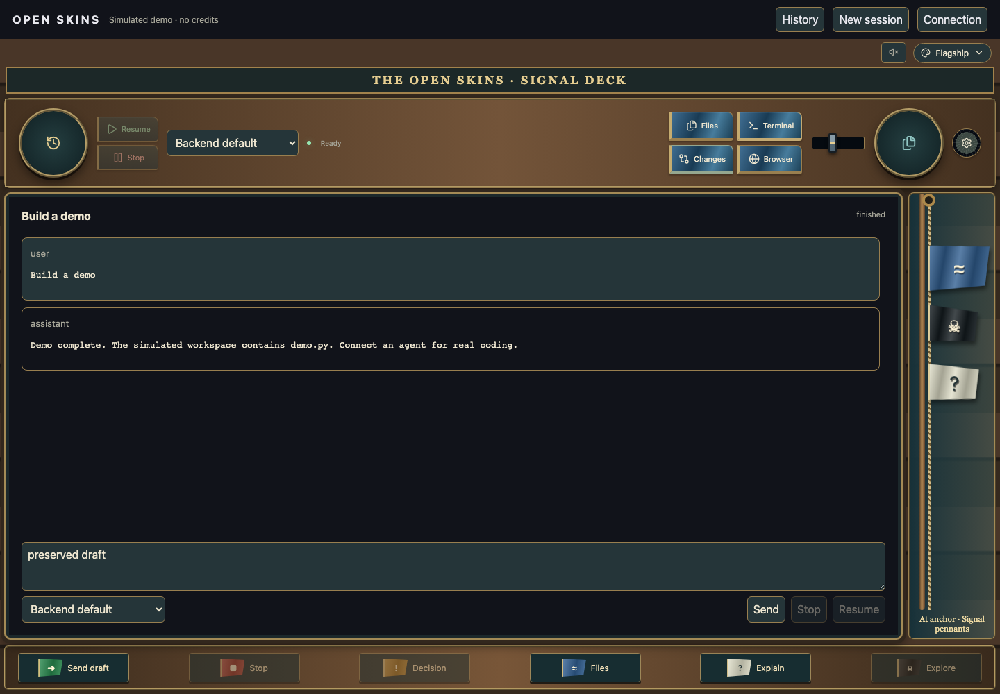

# Open Skins

A lightweight companion workspace for **OpenHands** and **OpenCode**. Install your coding agent normally, run Open Skins beside it, and choose a DJ booth, pilot cockpit, retro arcade cabinet, Ferrari-inspired dashboard, sailing-ship signal deck or standard workspace.

Shared typography, readable message cards, a compact composer and plain-language status labels keep the workspace consistent across skins. The skin gallery includes a short description of each interface.

The agent conversation stays central. Moving handles, switches, tool pads and optional sound packs control the same shared actions in every skin. Switching skins preserves your session and draft.



## Quick start

Requires [Node.js 24 or newer](https://nodejs.org/en/download) and Git. Open Skins contains the interface and adapters; it does not bundle a coding agent, Docker image or model runtime.

```sh
git clone --depth 1 --single-branch https://github.com/ZeevRispler/Open-Skins.git
cd Open-Skins
npm ci
npm run dev
```

Open **http://127.0.0.1:5180**. The initial **simulated demo** works without an account or API key. It demonstrates controls and virtual files; connect a real backend for actual coding.

Click the palette button to choose a skin, then send **Build a demo**. Send **slow demo** to see the DJ discs rotate and try Stop/Resume. The speaker button enables sound. This first run needs no `.env` file or installed agent.

The shallow clone downloads the current app without the inherited OpenHands Git history.

For a production build:

```sh
npm run build
npm start
```

## Connect your agent

After the free demo works, create a local configuration file:

```sh
cp .env.example .env
```

Set the URL for your installed agent, restart Open Skins, and click **Connection**. Keep account sign-in and model setup in the agent itself. The working directory is a path on the machine running the agent server.

### OpenHands

Start your existing **OpenHands Agent Server** and configure its URL in `.env`. See the official [Agent Server setup guide](https://github.com/OpenHands/docs/blob/main/sdk/arch/agent-server.mdx) if you have not installed it. This adapter targets the Agent Server REST API used by the TypeScript client, rather than the older OpenHands web application's API.

```dotenv
OPENHANDS_URL=http://127.0.0.1:8000
# If your server requires session authentication:
OPENHANDS_SESSION_KEY_FILE=/absolute/path/to/session-api-key.txt
```

Click **Connection**, enter an absolute working directory on the agent server, then **Connect openhands**. Select an existing session from History, or send a message to create one. The model menu selects a configured agent profile for new sessions. Configure models and provider sign-in in OpenHands itself.

Your existing Google-connected OpenHands runtime can remain installed separately. Open Skins does not implement Google sign-in or convert a consumer subscription into API access. Any supported account connection belongs to the backend agent.

### OpenCode

Install [OpenCode](https://opencode.ai/docs/), connect your provider using its normal account flow, and start its server in your project:

```sh
opencode serve --hostname 127.0.0.1 --port 4096
```

Set `OPENCODE_URL=http://127.0.0.1:4096` in `.env`, restart Open Skins, then choose **Connection → Connect opencode**. Supply the project directory if needed. The model menu lists the models of connected providers; **Backend default** preserves OpenCode's configured default.

If your OpenCode server uses a password, set `OPENCODE_SERVER_PASSWORD` and optionally `OPENCODE_SERVER_USERNAME` in `.env`. Server credentials stay in the local bridge, outside the browser bundle. This password authenticates the agent server; it is not a model provider API key.

### Capabilities

| Action                              | OpenHands Agent Server        | OpenCode                        |
| ----------------------------------- | ----------------------------- | ------------------------------- |
| Conversations and real coding tools | Yes                           | Yes                             |
| Stop                                | Pause                         | Cancel current turn             |
| Resume                              | Yes                           | Send a new message to continue  |
| Model selection                     | Agent profile for new session | Connected provider model        |
| Files                               | Open by path                  | Root file list and open by path |
| Terminal                            | Agent tool output             | Agent bash output               |
| Changes                             | Edit action summaries         | Backend patch output            |
| Permissions                         | Confirmation response         | Once / reject, agent questions  |
| Preview                             | Open URL in browser           | Open URL in browser             |

The companion is deliberately smaller than a full IDE: no embedded code editor, interactive shell, Git publishing controls or automatic backend installation. The existing agent remains responsible for tools, credentials, permissions and session storage. OpenHands currently shows the latest 400 events. Tool output and patch panels are read-only.

## Skins and feedback

DJ decks now have grooved vinyl, a spindle, session/tool labels and tonearms that lower during work and return when it stops. Platters rotate in opposite directions while the agent is working, with a reactive equalizer beside its status light. They pause when work stops, finishes, or needs approval. These indicators follow agent activity. Click the left deck for history or the right to cycle tools; arrow keys on the right select tools. Drag either vinyl to scratch without activating panels. Scratch cues are synthesized locally, throttled and silent unless sounds are enabled. The compact mixer has a Tools fader and a Lights fader that adjusts only the conversation backdrop.

The cockpit has a radar sweep during agent work and metallic ball-tip switches for history and tool panels. The blue arcade cabinet has a speckled deck, black joystick, red/white/blue/green buttons and a cream marquee. Tool names remain on the pads without small letter badges. Resume and Stop remain readable when disabled. Its retro character walks during work and celebrates completion. The cockpit and retro lever supports dragging or arrow keys: **left Files, up Terminal, down Changes, right Browser**. Clicking it still cycles through tools; clicking an active tool pad closes that panel.

The Retro joystick now pivots around its socket while dragging or holding arrow keys, then holds the selected direction like the cockpit lever. Its cream marquee and green fourth button complement the blue cabinet.

Flagship adds a timber-and-brass frame and a cloth signal flag that rises while working or awaiting a decision. Green sends the current draft or resumes where supported; red stops; amber focuses the pending approval; blue opens files; white appends an explanation request without sending it. The pirate flag starts a new session when no draft or task is active. Signal controls span the lower deck, while the side mast carries up to three waving flags for status, the ship pennant, and draft or workspace context. On small screens the signals become a compact button rack.

The Ferrari-inspired dashboard adds red bodywork, carbon-fiber panels, a gauge that reacts to agent activity, and a gearshift-shaped tool selector. Yellow trim complements the red bodywork. It shares the same directional controls and opt-in sounds.

DJ and Cockpit have distinct decorative racks on wide screens. DJ uses twin VU meters, level bars, faders and patch leads; Cockpit uses an attitude indicator, compass, annunciators and a round activity dial. It follows agent activity without displaying invented telemetry, and disappears below 1100px to preserve workspace space.

The conversation background adds a pixel skyline, cockpit clouds, DJ lighting, ship waves or racing road markings behind opaque message cards. Cockpit clouds drift in two layers, ship waves roll with gentle swells, and DJ lights sweep slowly through haze even while idle. Retro and racing scenery follow agent work. All backgrounds respect reduced motion and cannot intercept clicks.

The palette button opens a compact skin gallery. Sounds are **off by default**; enable them with the speaker button. Each skin has synthesized local press, completion, permission and error cues. Background tabs stay quiet, and motion respects the operating system's reduced-motion preference.

| Cockpit                                             | Retro console                                   |
| --------------------------------------------------- | ----------------------------------------------- |
|  |  |





Interactive visual studies are available at `/design-studies/index.html` while the app is running.

Screenshots above are captured from this app's browser regression tests, using the clearly labeled simulated demo.

## Troubleshooting

| Symptom                               | What to check                                                                                |
| ------------------------------------- | -------------------------------------------------------------------------------------------- |
| Node or npm is missing                | Install Node.js 24 or newer, then reopen the terminal.                                       |
| Port 5180 is busy                     | Run with a different `PORT` in `.env` and open that port.                                    |
| Agent connection fails                | Start the agent server and check its URL in `.env`; restart Open Skins after editing it.     |
| OpenHands returns 401                 | Set the server session token or token-file path in `.env`.                                   |
| OpenHands cannot create a session     | Set an absolute working directory in Connection and configure an agent profile in OpenHands. |
| No OpenCode models appear             | Connect a provider in OpenCode first; restart or reconnect the companion.                    |
| Sound is quiet or animation is static | Enable the speaker button; check browser/OS volume and reduced-motion preferences.           |

## Architecture

```text
src/core/                 Shared sessions, snapshots, messages and capability contracts
src/adapters/             OpenHands, OpenCode and free simulated-demo implementations
src/workspace-core/       Connection lifecycle, polling and shared workspace commands
src/interfaces/           Skins, hardware controls, animation and sound packs
src/main.tsx              Common conversation and tool panels
scripts/bridge.mjs        Local fixed-target proxy and server-side session authentication
```

Skins never import an agent SDK. Add another backend by implementing `AgentAdapter`; add a skin without changing the backend or coding functions. The browser talks only to the local bridge, which routes to configured backend addresses. Open Skins binds to loopback; this is a local companion, not a hosted multi-user service.

## Tests

```sh
npm run check
npx playwright install chromium
npm run test:e2e
```

Unit tests cover sound lifecycle, stop/resume, permissions, adapter state normalization and bridge origin checks. Chromium tests exercise every skin, draft preservation, files, tool pads, history, moving selectors, approvals, errors and mobile layout. Optional real-server tests are in `tests/backends.spec.ts`; see [integration testing](docs/testing.md). They use local inference fixtures and spend no provider credits.

## Migration from the fork

The earlier OpenHands fork is preserved on [`codex/openhands-fork-archive`](https://github.com/ZeevRispler/Open-Skins/tree/codex/openhands-fork-archive). This standalone branch retains the skins and license attribution, while removing the bundled OpenHands source, backend packaging and account onboarding. Existing installations remain separate and can be connected through the adapters.

MIT licensed. The original OpenHands license and attribution are retained in [LICENSE](LICENSE).
