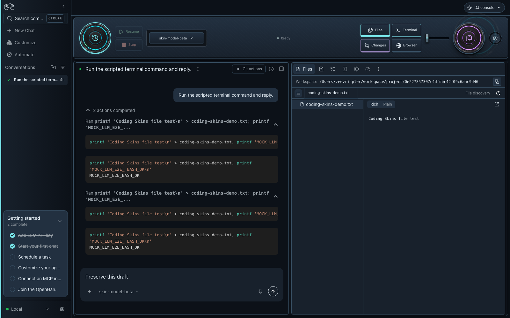
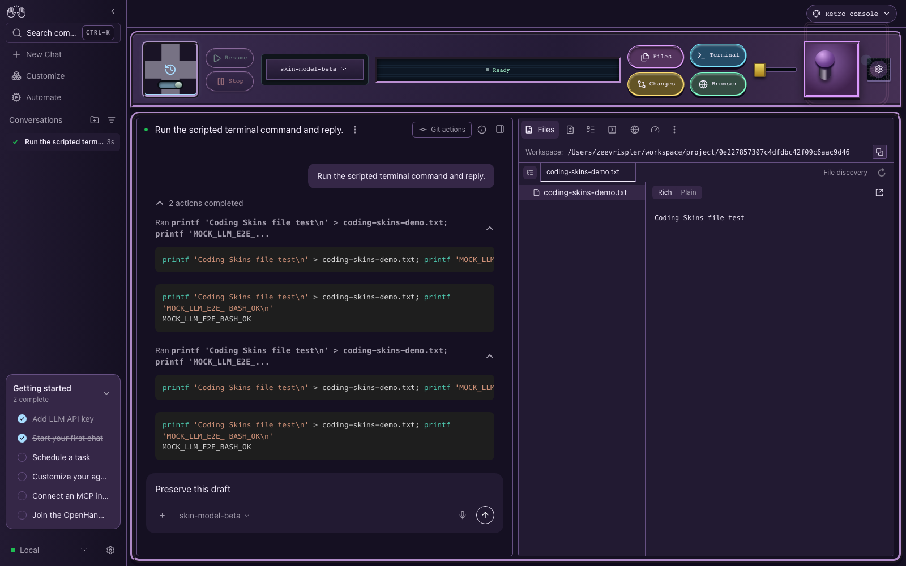
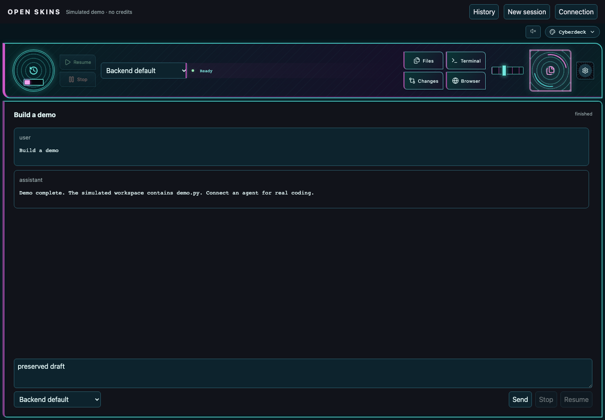

# Open Skins

Interchangeable coding-agent interfaces built on OpenHands. Choose Standard, DJ console, Cockpit, Retro console, or Cyberdeck, backed by the same agent connections and coding functions.

## Screenshots

Actual screenshots from the running application, captured during browser tests with the real OpenHands Agent Server and a local scripted model. The controls operate the shared coding workspace; these are not design mockups.

| DJ console                                                                                                      | Cockpit                                                                                                |
| --------------------------------------------------------------------------------------------------------------- | ------------------------------------------------------------------------------------------------------ |
|  |  |

| Retro console                                                                                                             | Cyberdeck                                                                                                          |
| ------------------------------------------------------------------------------------------------------------------------- | ------------------------------------------------------------------------------------------------------------------ |
|  |  |

The agent screen stays central. Switches, joystick positions, instrument needles and selector rings reflect the actual history and tool state. Choose a skin from the compact picker; keyboard controls and reduced-motion preferences are supported.

Optional skin-specific sounds provide button feedback and agent completion, approval and error cues. Enable them with the speaker button; activity lights follow real agent state and respect reduced-motion preferences.

## Start here

Requires Node.js 24+, npm and uv.

```sh
git clone https://github.com/ZeevRispler/Open-Skins.git
cd Open-Skins
npm ci
npm run dev
```

Open the URL printed by the launcher, configure an agent through the OpenHands setup screens, and choose a skin from the upper-right picker.

| Guide                                                                | Contents                                                      |
| -------------------------------------------------------------------- | ------------------------------------------------------------- |
| [Getting started](docs/open-skins/getting-started.md)                | Run locally, try the free scripted demo, build and test       |
| [Agents and accounts](docs/open-skins/agents.md)                     | Existing OpenHands connections and optional provider login    |
| [Architecture and skin development](docs/open-skins/architecture.md) | Shared coding functions, skin ownership and repository layout |
| [Upstream documentation](docs/README.md)                             | ACP agents, self-hosting, development and runtime details     |

## Foundation and license

Open Skins is a fork of [OpenHands Agent Canvas](https://github.com/OpenHands/OpenHands), with its agent runtime, tools, approvals and provider integration retained. It is currently a modular fork, rather than a standalone skin plugin SDK. The five skins share one active conversation workspace.

The upstream npm package `@openhands/agent-canvas` installs OpenHands; clone this repository to use Open Skins. Dependency pins and the upstream package identity remain intact while this fork is developed.

[MIT license](LICENSE). OpenHands attribution and the upstream changelog are retained.
